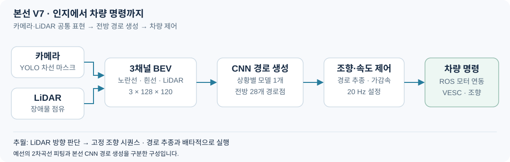

# 국민대 자율주행 · 카메라·LiDAR 기반 경로 생성

시뮬레이터에서 만든 주행 로직을 실차로 옮기며, 차선 표현·학습 데이터·추론 지연·차량 제어를 함께 개선한 프로젝트입니다. **전체 참가 114팀 중 본선 22팀에 진출해, 전체 코스를 완주하고 최종 8위**를 기록했습니다.

`Python` · `ROS 2 / ROS 1` · `OpenCV` · `YOLO` · `PyTorch` · `OpenVINO` · `VESC`

## 시스템 흐름

예선은 **BEV의 노란 중앙선에 2차곡선을 맞추는 방식**이었습니다. 본선에서는 노란선·흰선·LiDAR를 3채널 BEV로 묶어 CNN으로 전방 28개 경로점을 생성했습니다. 아래 구현과 성능은 본선 V7 기준입니다.

## 주행 자료

| 단계 | 확인할 자료 |
|---|---|
| 본선 실차 | [대회 중계 · **4:24:32–4:27:32**](https://www.youtube.com/watch?v=CcfXS3UFL0A&t=15872s) |
| 예선 시뮬레이션 | [전체 주행 영상 · 약 3분 16초](media/simulation.mp4) · [첫 45초](media/simulation-preview.mp4) |

[개발 단계와 영상 안내 →](docs/demo.md)

## 핵심 구현

### 1. 차선 정보 손실을 찾아 경로 입력 재설계

갈림길이 사라지는 원인은 낮은 해상도보다 **후처리에서 같은 거리의 차선을 대표점 하나로 합치는 것**이었습니다. 마스크의 2차원 형태를 보존하고, 노란선이 부분적으로 검출돼도 흰선과 장애물 정보를 함께 활용하도록 입력을 바꿨습니다.

### 2. 학습 데이터와 실차 센서 입력의 차이 줄이기

LiDAR를 추가하자 오히려 경로가 나빠졌습니다. 같은 장면에서 채널만 켜고 끄며 원인을 좁히고, 실제 카메라·LiDAR 데이터를 다시 수집했습니다. 학습과 실행의 전처리를 통일하고, 일반 도로와 라바콘 구간의 필터를 구분했습니다. 정답 경로는 후보를 검수·수정해 구축했습니다.

### 3. 추론과 차량 제어를 함께 계측

단독 실행 약 50 ms의 검출 모델이 실주행에서는 평균 약 181 ms까지 느려졌습니다. 불필요한 영상 전송과 CPU 경합을 줄이도록 필요한 토픽만 연결하고, 최신 프레임 버퍼와 공유 메모리를 적용했습니다. 제어는 **20 Hz 설정**으로 분리하고 속도 명령의 변화량을 제한했습니다.

최종 추월은 LiDAR로 장애물 방향을 판단한 뒤 **고정 조향 시퀀스**를 실행합니다. 이때 경로 추종과 같은 제어 노드에서 배타적으로 동작해 차량 명령을 일원화했습니다.

## 결과와 검증

| 항목 | 결과 · 조건 |
|---|---|
| 대회 | **전체 코스 완주 · 본선 8위** · 2026.08.25 |
| 일반 경로 CNN | **MAE 8.045 cm** · 주행 시퀀스 단위로 분리한 테스트 321장 |
| YOLO 추론 비교 | p50 **91.76 → 51.03 ms** · 같은 녹화 프레임, PyTorch → OpenVINO |
| 경로 발행률 | **11.948 Hz** · 2026.08.21, 뷰어·브리지 제외 계측 |

모델 단독 성능과 전체 시스템의 실행 조건을 구분해 기록했습니다. 입력·경로·모드·차량 명령은 별도 진단 뷰어로 확인했습니다.

## 문서와 코드

- [문제 해결 사례](docs/engineering-cases.md): BEV 비교, 데이터 구축, 센서 분포, 지연과 모터 제어
- [성능·설계·실행 조건](docs/technical-notes.md): 모델 평가, 처리율, 차량 PC와 배포 환경
- [코드 안내](docs/source-guide.md): 인지 → 경로 생성 → 제어 단계별 파일과 원본 출처
- [예선·본선 전체 코드](https://github.com/jounget5411-lab/2026-Legend-KHUSLA)

[대표 프로젝트 목록으로 돌아가기](https://github.com/jounget5411-lab/portfolio)
