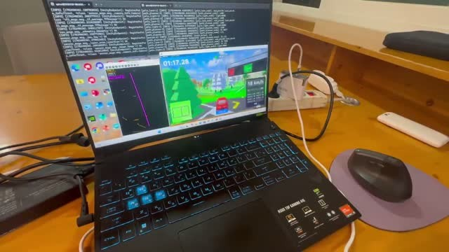

# 본선 실차와 예선 시뮬레이션

[프로젝트 소개](../README.md) · [실차 문제 해결](engineering-cases.md) · [본선 성능과 조건](technical-notes.md)

## 본선 실차 주행

**[본선 실차 주행 · 4:24:32–4:27:32](https://www.youtube.com/watch?v=CcfXS3UFL0A&t=15872s)**

대회 중계 중 팀의 실차 주행 구간입니다. 링크는 4:24:32부터 시작하며, 해당 구간은 4:27:32까지 약 3분입니다.

출처: [YouTube 대회 중계 원본](https://www.youtube.com/watch?v=CcfXS3UFL0A)

## 예선 시뮬레이션 주행

사진을 누르면 **예선 시뮬레이션 주행 영상 전체본(약 3분 16초)**을 볼 수 있습니다. 노트북의 시뮬레이터 차량 화면, 경로 표시와 터미널 출력을 함께 촬영했습니다.

[첫 45초 미리보기](../media/simulation-preview.mp4) · [전체 영상](../media/simulation.mp4)

## 예선에서 본선 실차로

| 단계 | 주행 구성 | 연결 자료 |
|---|---|---|
| 예선 시뮬레이션 | YOLO 인식, 기존 BEV의 2차곡선 피팅, 상태 머신과 다점 경로 추종 | [예선 영상](../media/simulation.mp4) · [예선 코드](https://github.com/jounget5411-lab/2026-Legend-KHUSLA/tree/8036461664402a54821b0665a4434e961f9a2e76/예선/src/track_drive) |
| 본선 실차 | 3채널 BEV 입력의 CNN 경로 생성, 모드별 제어, 고정 조향 기반 추월 | [실차 주행 영상](https://www.youtube.com/watch?v=CcfXS3UFL0A&t=15872s) · [실차 개발 과정](engineering-cases.md) · [본선 측정 조건](technical-notes.md) |

실차에서 부분적으로 검출된 점선과 갈림길의 정보 손실을 확인한 뒤, 기존 BEV의 2차원 차선 형태를 보존하고 CNN 경로 생성으로 전환했습니다. 본선의 모델 평가·처리율·대회 결과는 해당 단계의 기록과 함께 정리했습니다.
